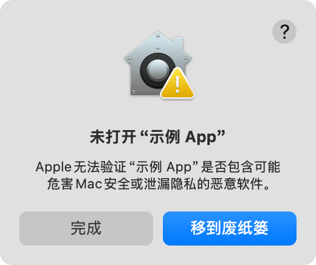
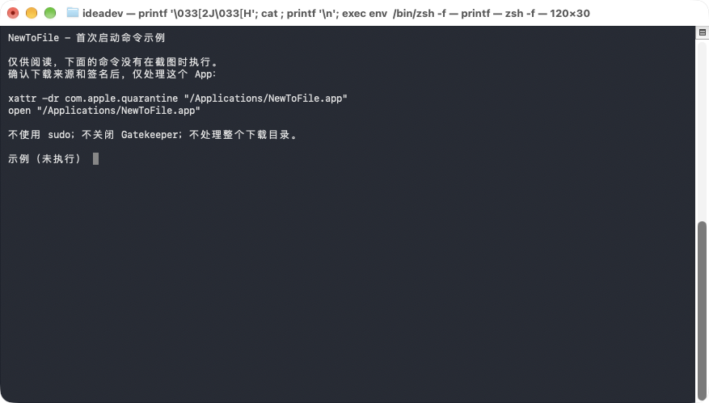
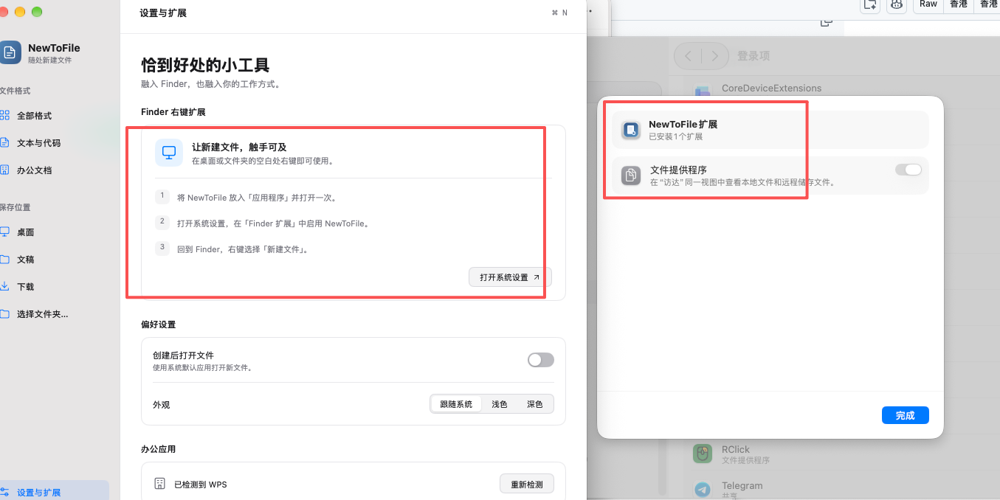

# NewToFile · 随处新建文件

一个使用 [MyGo Native UI](https://mygo.egoist.dev/docs/ui) 编写的原生 macOS 小工具。主界面为 Go / MyGo 0.4.8，使用 Metal 和 Core Text 绘制，不使用 HTML、JavaScript 或 WebView；Finder 扩展与安全文件创建核心保留 Swift / AppKit 实现。

在 Finder 文件夹或桌面的右键菜单里选择「新建文件」，输入名称后创建文件；也可以从菜单栏入口选择任意文件夹。

[English](README.en.md) · [下载预览版](https://github.com/logdns/newtofile/releases) · [GitHub](https://github.com/logdns/newtofile) · [官方网站](https://www.xinai.de/) · [更新记录](CHANGELOG.md)

> v0.2.3 公开包使用 NewToFile 独立证书自签名，仍为未公证预览版。请阅读安装限制，勿关闭系统安全保护。

[首次打不开？两种解决方法](#macos-首次打不开两种解决方法) · [启用 Finder 右键扩展（图文）](#启用-finder-右键扩展图文)

## 原生界面


[深色预览](docs/screenshots/dark.png) · [修复后的浅色设置页](docs/screenshots/settings-light.png)

以上由 MyGo 原生渲染器生成，路径已脱敏，不包含 AppKit 窗口边框。

- 隐藏式标题栏保留系统红黄绿窗口按钮；可拖动标题栏和侧栏上方移动窗口。
- 跟随系统时使用 Vibrancy 半透明侧栏；手动指定浅色/深色时使用匹配外观的实色侧栏，避免材质与文字混色。按「全部格式 / 文本与代码 / 办公文档」分类。
- 桌面、文稿、下载快捷入口，使用系统原生文件夹选择面板。
- 文件格式图标、实时文件名预览、创建状态与错误提示。
- 跟随系统浅色 / 深色外观，也可以在设置中单独选择外观。
- 独立设置页包含 Finder 扩展引导、办公应用检测、创建后打开选项。
- 支持中文输入法、键盘焦点、复制粘贴和 VoiceOver 语义。`Command + N` 新建窗口入口，`Command + Return` 创建文件，`Command + ,` 打开设置。

## 功能

- 支持 TXT、Markdown、RTF、JSON、CSV、HTML。
- 检测到 Microsoft Word、Excel、PowerPoint 时，分别显示 DOCX、XLSX、PPTX；检测到 WPS 时显示全部三种办公格式。
- 办公文件使用真实 OOXML 模板：一页空白 Word 文档、一个空白 Excel 工作表、一张 16:9 空白幻灯片。不是只有后缀的空文件。
- 同名文件自动追加 ` 2`、` 3` 等序号，不覆盖原文件或符号链接；可选创建后直接打开，否则在 Finder 中选中新文件。
- 右键单个文件夹时在该文件夹内创建；右键文件时在其所在文件夹创建；空白处右键使用当前文件夹。
- 外接磁盘挂载后自动更新 Finder 扩展监听范围。只读磁盘、系统保护位置和没有写权限的目录不能创建。
- 所有操作在本机完成，不联网，不上传文件名、内容或路径。不需要授予辅助功能或全磁盘访问权限。

## 环境

- macOS 13 Ventura 或更高版本。
- 构建需要 Go 1.27.1 或更高版本、Xcode / 对应 SDK 和 Python 3。可先运行 `go version` 和 `xcode-select -p` 检查工具链。
- `go.mod` / `go.sum` 固定 MyGo 0.4.8 及依赖；首次构建需要下载 Go 模块，安装后的 App 运行不需要联网。
- `Package.swift` 用于 Swift 核心库和测试；App、Swift 文件服务与 Finder 扩展由构建脚本直接编译、打包，不需要 Node.js、前端构建或 XcodeGen。

## 构建与安装

```bash
./scripts/build.sh
open build
```

生成 `build/NewToFile.app`，默认编译本机 CPU 架构并使用本地 ad-hoc 签名。将它拖入「应用程序」，首次打开一次，然后：

1. macOS 15 / 26 及更新系统：在「系统设置 → 通用 → 登录项与扩展」中启用 **NewToFile** 对应扩展。不同版本可能按「Finder」「文件提供程序」或 App 名称分组，详见下方图文。
2. macOS 13 / 14：在「系统设置 → 隐私与安全性 → 扩展 → Finder 扩展」中启用 **NewToFile**。
3. 在桌面或 Finder 文件夹的空白处右键，选择「新建文件 → 纯文本 (.txt)…」。
4. 输入名称并点击「创建文件」，快捷键是 `Command + Return`。

App 可以关闭窗口后留在菜单栏运行；即使退出 App，已启用的 Finder 扩展也会在使用时重新打开它。不自动启用扩展、不修改 Finder 偏好设置、不自动设置开机启动。

如果扩展没有出现，确认 App 已在「应用程序」并打开过，重新开关扩展，关闭并重新打开 Finder 窗口；必要时手动重新启动 Finder。不要同时保留多个已启动的 NewToFile 副本，以免 URL 协议指向旧版本。

### macOS 首次打不开？两种解决方法

从 [GitHub Releases](https://github.com/logdns/newtofile/releases/latest) 下载匹配架构的 DMG 或 ZIP，将 **NewToFile.app** 拖入「应用程序」（`/Applications`）。Apple Silicon / M 系列选择 `arm64`，Intel 选择 `x86_64`。

当前版本为**自签名、未经过 Apple 公证的预览版**。首次双击可能提示「Apple 无法检查此 App 是否包含恶意软件」或「无法验证开发者」。这不等于已经检测到恶意软件，也不表示 App 一定安全；**只有在确认项目来源、下载文件和签名后，才考虑以下操作**。校验方法见 [自签名说明](docs/self-signing.md#inspect-a-download)；校验和只能核对下载完整性，不能证明软件安全。



上图来自 [Apple 官方说明](https://support.apple.com/zh-cn/102445)，其中「示例 App」不是 NewToFile 的本机测试截图。不同 macOS 版本的提示文字可能不同。

#### 方法一：系统设置「仍要打开」（推荐）

1. 先在「应用程序」中双击 **NewToFile.app** 一次；遇到上述安全提示时点击「完成」或关闭提示。
2. 打开「系统设置 → 隐私与安全性」（部分版本显示「隐私与安全」），向下滚动到「安全性」区域。
3. 确认被阻止的应用名称是 **NewToFile**，点击旁边的「仍要打开」。不要为其他不认识的 App 放行。
4. 根据系统提示使用 Touch ID 或 Mac 登录密码确认；若再次出现提示，确认名称后点击「打开」。


上图为 Apple 官方 macOS Sequoia 示例；你的系统布局和按钮位置可能不同。「仍要打开」通常只在尝试启动后约一小时内显示。若看不到，可重新尝试打开 App 后再查看；受公司管理策略或系统限制时可能不可用。

#### 方法二：仅移除 NewToFile 的下载隔离标记（备用）

如果系统设置没有提供可用的入口，且你已确认下载可信，可在「终端」执行以下两行。**此操作会移除这个 App 的下载隔离保护，是你主动接受未公证软件的风险，不会使自签名变成 Apple 公证。** 优先选择方法一或从源码构建。

```bash
xattr -dr com.apple.quarantine "/Applications/NewToFile.app"
open "/Applications/NewToFile.app"
```



上图是终端中展示命令的真实截图，**截图时未执行这两条命令，不是成功解除系统拦截的验收证明**。

- `-r` 仅处理指定 App 包内部的文件；**不要把路径换成 `/Applications`、下载目录、磁盘根目录或通配符**。
- 若提示 `No such file`，先检查 App 是否已经移入「应用程序」且名称完全一致；若提示权限不足，不要直接追加 `sudo`，先检查文件所属用户，或改用方法一 / 从源码构建。
- 不要全局禁用 Gatekeeper，不要将自签名证书添加为信任根，也不要重新签名已下载的 App。
- 如果提示「会损坏你的电脑」、已检测到恶意软件，或签名验证失败，**停止操作，不要绕过警告**；删除该下载并向项目反馈。以上方法也不保证解决真正损坏的文件、架构不匹配或扩展签名问题。

### 启用 Finder 右键扩展（图文）

**能打开 App 不等于已启用 Finder 扩展。** 完成首次启动后，还需要单独开启扩展，桌面和 Finder 才会出现「新建文件」右键菜单。

1. 确认 **NewToFile.app** 已放入「应用程序」，打开一次。不要同时运行 DMG 内、下载目录中或旧版本的副本。
2. 在 App 左下角点击「设置与扩展」，找到「Finder 右键扩展」卡片，点击「打开系统设置」。如果按钮没有跳到对应页面，按下一步手动进入。
3. macOS 15 / 26 及更新系统：进入「系统设置 → 通用 → 登录项与扩展」，在扩展区域找到 **NewToFile** 对应项目并打开详情。系统版本不同，入口可能按 **Finder / Finder 扩展 / 文件提供程序** 分类，也可能直接显示 **NewToFile 扩展**。macOS 13 / 14：进入「系统设置 → 隐私与安全性 → 扩展 → Finder 扩展」。也可在系统设置中搜索「扩展」。
4. 确认详情属于 **NewToFile**（名称可能显示为「NewToFile Finder」或「NewToFile 扩展」），开启它下面的扩展开关。**按下图的系统布局，就是打开「NewToFile 扩展」详情，开启其下的「文件提供程序」开关，再点击「完成」。** 不要开启其他 App 的同名项目。
5. 回到桌面或 Finder 文件夹，在空白处右键，选择「新建文件 → 纯文本 (.txt)…」。输入名称并点击「创建文件」；按 `Command + Return` 也可以创建。



**读图提醒：** 左侧红框是 App 内的操作引导，右侧红框表示系统识别到了「NewToFile 扩展」；图中的开关目前是关闭状态。系统界面的分类标签会随版本变化，截图中显示「文件提供程序」，不能仅凭这个标签判断扩展的实现类型。本项目实际注册的是 `com.apple.FinderSync`，不是云盘同步服务。请以 **NewToFile 对应项目** 为准，并在开启后按第 5 步确认右键菜单；「已安装 1 个扩展」或开关开启本身都不等于已完成验收。若列表中找不到 NewToFile，请反馈 macOS 版本与截图，不要修改系统扩展文件或盲目授予其他权限。

若开关已开启但菜单未出现，先关闭并重新打开 Finder 窗口，再尝试重新开关扩展。仍不生效时，可保存正在进行的 Finder 操作后，按住 `Option` 右键点击 Dock 中的 Finder，选择「重新开启」。自签名版本在某些系统上仍可能无法启用扩展；这与首次启动放行是不同问题，可暂时通过 App 的「选择文件夹…」创建文件。

图片来源与验证边界见 [截图说明](docs/screenshots/README.md)。

安装 Office / WPS 后点击格式区域的刷新按钮或「设置与扩展 → 重新检测」，并重新打开右键菜单。系统必须能够识别安装应用的 Bundle ID；压缩包内或没有启动注册过的应用可能检测不到。

偏好设置保存在 `~/Library/Application Support/NewToFile/preferences.json`。第一次升级到 MyGo 界面时，会读取旧版的保存位置和「创建后打开」偏好，不更改原偏好数据。

## 验证

```bash
go test ./...
go test -race ./...
go vet ./...
swift test
python3 scripts/test_templates.py
python3 scripts/test_app.py
./scripts/preview.sh
```

- Go 的 MyGo `ui.NewTester` 测试覆盖格式选择、分类、名称编辑、创建快捷键、位置切换、设置开关、双外观及最小窗口尺寸；另有请求解析和偏好持久化测试。
- Swift 测试覆盖文件内容、同名保护、符号链接、32 路并发创建、非法名称和 Finder → App 请求编码。
- Python 检查办公模板 ZIP 完整性、XML、内容类型及内部关系引用。此检查不替代在 Office / WPS 中实际打开文件的兼容性验收。
- `test_app.py` 在临时目录测试已打包的 Swift 文件服务，验证真实可用格式的创建、中文路径、同名保护和错误回执。需要先构建 App。
- 预览脚本通过 MyGo 原生渲染器输出 `build/preview.png`、`build/preview-dark.png`、`build/preview-settings.png`；不需要屏幕录制权限，不创建用户文件、不读写用户偏好。另输出 `preview-forced-light.png`、`preview-forced-dark.png`，模拟系统与 App 外观相反的情况。静态预览不等于真实 AppKit 材质验收。

### 手动验收

- 桌面空白处、普通文件夹、中文/空格/`&` 路径、外接可写磁盘分别新建 TXT。
- 对单个文件夹、单个文件及多选同目录文件右键，确认目标位置正确。
- 连续创建同名文件，确认原文件内容不变。
- 未安装 Office / WPS 时不显示办公格式；安装对应应用后刷新并确认菜单变化。
- 在 Word / Excel / PowerPoint 或 WPS 中实际打开新文件，确认无修复提示且能保存。
- 在只读目录创建，确认显示错误、不留下半成品。
- 测试 App 已退出时从 Finder 发起创建，确认能打开 App 并保留目标路径。

## 签名与分发

GitHub Releases 提供 Apple Silicon / Intel 分开的 ZIP 和 DMG 预览包，以及 `SHA256SUMS.txt`。v0.2.3 产物为独立证书自签名（v0.2.1 为 ad-hoc），**尚未通过 Apple 公证**，不是生产就绪的正式安装包。Gatekeeper 可能阻止启动，Finder 扩展在部分系统上可能要求有效的开发签名。Intel 包为交叉构建，尚需 Intel 实机验收。

下载与电脑架构匹配的包，将 App 拖入「应用程序」。可先运行 `shasum -a 256 -c SHA256SUMS.txt` 核对同目录下载的全部资产。若系统提示无法验证开发者，优先从源码构建；仅对确认来源的 App 使用系统设置提供的「仍要打开」操作。不同 macOS 版本对未公证 App 的限制不同，此操作不保证可用。**不要全局禁用 Gatekeeper，也不要对整个下载目录递归移除隔离标记。**

有 Apple Developer 证书时可以使用：

```bash
SIGN_IDENTITY="Developer ID Application: Your Name (TEAMID)" ./scripts/build.sh
```

公开分发前需要为 App 和扩展使用一致的有效签名，提交 Apple 公证、装订票据，并在干净的 macOS 用户环境中验证安装、扩展启用和办公兼容性。运行 `./scripts/package.sh` 可在独立架构目录构建两种版本，并输出 ZIP、DMG 和校验和。单架构可使用 `ARCH=x86_64 OUTPUT_DIR=build/x86_64 ./scripts/build.sh`。详见 [发布流程](docs/releasing.md)。

## 结构与权限

```text
cmd/newtofile/              MyGo App 生命周期、菜单栏、窗口和系统对话框
internal/appui/             MyGo 原生界面、状态及 UI 测试
internal/filebridge/        Go → Swift 文件服务与 Finder URL 解析
internal/preferences/      本地偏好持久化
Sources/FileHelper/        Swift JSON 文件服务，复用原文件创建核心
Sources/FinderExtension/    Finder 右键菜单及目标文件夹解析
Sources/NewToFileCore/      文件类型、应用检测、文件创建及 URL 请求
Resources/Templates/       可重建的空白办公模板
Resources/                 Bundle 配置和扩展沙盒权限
Tests/                     Swift 单元测试
scripts/                   构建、模板生成、校验和原生 UI 预览
```

Finder 扩展在沙盒中运行，只负责菜单和路径；通过 `newtofile://create` 唤起 MyGo 主 App。主 App 使用单实例机制，所有 URL 请求只会预填可见表单，必须点击创建，不会仅凭外部 URL 自动写文件。

主 App 和随包签名的 `NewToFileBridge` 文件服务不启用 App Sandbox，以便写入用户确认的目标位置。Go 使用标准输入 / 输出 JSON 调用本机 Swift 文件服务，不执行拼接 shell 命令；文件服务继续使用已测试的独占创建逻辑和真实模板。macOS 的桌面、文稿、下载、移动卷访问授权和其他文件系统权限仍然有效，权限被拒绝时会明确报错。未做 Mac App Store 分发适配。

当前不支持旧二进制格式 `.doc`、`.xls`、`.ppt`，也不支持 iCloud 尚未下载目录、所有第三方虚拟文件系统及搜索结果视图。Finder 扩展监听的是文件夹，不是屏幕坐标；文件的桌面图标摆放位置由 Finder 决定。

## 开源与反馈

项目源码采用 [MIT 许可证](LICENSE)。第三方组件保留各自许可证，见 `Resources/ThirdParty/`，这些声明随 App 分发。

- 问题与功能建议：[GitHub Issues](https://github.com/logdns/newtofile/issues)。
- 参与开发：[CONTRIBUTING.md](CONTRIBUTING.md)。
- 漏洞反馈与权限边界：[SECURITY.md](SECURITY.md)。
- 本次审计范围、结果与限制：[安全审计记录](docs/security-audit.md)。
- v0.2.3 关于链接的限定范围源码审查：[审计记录](docs/security-review-0.2.3.md)。
- 卸载：先禁用 Finder 扩展、退出菜单栏 App，再移除应用；如不需要保留偏好，可删除 `~/Library/Application Support/NewToFile/`。不要删除你创建的文档。

[Version 0.2.1 validation record](docs/validation.md)

[自签名说明与证书指纹](docs/self-signing.md) · [v0.2.3 验证记录](docs/validation-0.2.3.md)
